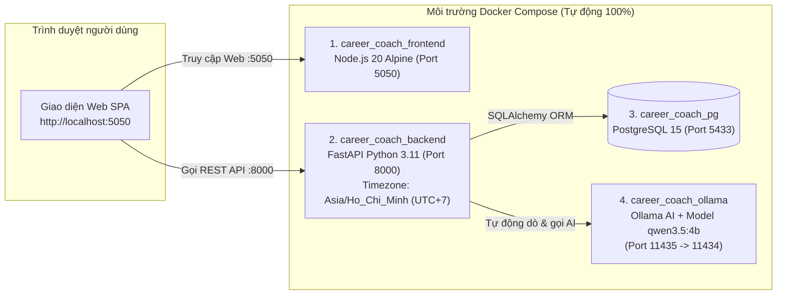

# 🌱 AI Career Coach - Hệ Thống Định Hướng Nghề Nghiệp Đa Ngành, Lập Lộ Trình Học Tập & Phỏng Vấn Thử AI

> **Đề án / Bài thi thực hành**: Ứng dụng Trí tuệ Nhân tạo (**LLM Qwen 3.5:4b qua Ollama** kết hợp **Hệ thống Trích xuất Kỹ năng Đa ngành Universal**) cùng **FastAPI**, **PostgreSQL 15** và **Gamification** hỗ trợ người học ở **tất cả các ngành nghề** phân tích khoảng trống kỹ năng (Skill Gap) từ CV & JD tự do, tự động lập lịch học theo thời gian rảnh (múi giờ Việt Nam `UTC+7`) và luyện phỏng vấn ngẫu nhiên đa vòng theo mô hình chuẩn **STAR**.
>
> **Đặc điểm nổi bật khi triển khai**: Toàn bộ hệ thống gồm **4 thành phần (Database PostgreSQL + AI Server Ollama + Backend FastAPI + Frontend Web)** đã được đóng gói **100% bên trong Docker**. Người chấm bài / người dùng tải về từ GitHub **không cần cài đặt Python, Node.js, PostgreSQL hay Ollama ngoài máy thật**, chỉ cần chạy duy nhất lệnh `docker compose up --build -d`.

---

## 📌 1. Giới thiệu tổng quan

**AI Career Coach** giải quyết bài toán định hướng nghề nghiệp và huấn luyện kỹ năng cho sinh viên / người đi làm ở mọi lĩnh vực thông qua quy trình khép kín 4 bước:
1. **Đánh giá năng lực hiện tại (Đa ngành nghề)**: Trích xuất tự động kỹ năng và kinh nghiệm từ file CV PDF tải lên hoặc chọn bộ hồ sơ mẫu đa lĩnh vực. Hỗ trợ nhận diện kỹ năng trên **12 nhóm ngành lớn** (*CNTT/Phần mềm, Dữ liệu/AI, Tài chính/Kế toán/Kiểm toán, Luật/Pháp chế, Marketing/Truyền thông, Nhân sự/HR, Kinh doanh/Sales, Logistics/Chuỗi cung ứng, Kỹ thuật/Sản xuất, Y dược, Giáo dục, Thiết kế/Sáng tạo*).
2. **Phân tích Độ khớp & Kết luận Chuyên sâu (Universal Skill-Gap & JD Analysis)**: So khớp hồ sơ với vị trí mẫu hoặc **Mô tả công việc (JD) dán tự do của bất kỳ ngành nào**. Chấm điểm theo công thức trọng số, vẽ biểu đồ Radar năng lực theo nhóm ngành và đưa ra **Báo cáo Kết luận & Đánh giá chuyên sâu** đa chiều.
3. **Lên lộ trình học tập & Băm giờ thông minh (Smart Study Planner - Múi giờ `UTC+7`)**: Thiết kế các bài học bù đắp đúng các kỹ năng còn thiếu, tự động cắt nhỏ thời lượng bài học để lấp vừa khít các khung giờ rảnh thực tế của người học và tự động mở khóa đúng giờ (`unlock_time` theo chuẩn giờ Việt Nam `Asia/Ho_Chi_Minh`).
4. **Luyện phỏng vấn Ngẫu nhiên Đa vòng & Chấm điểm STAR + Gamification**: Giả lập phòng phỏng vấn với 4 vòng (*Vòng Nhân sự HR, Vòng Chuyên môn Tech Lead, Vòng Văn hóa Culture Fit, Vòng Cuối Hiring Manager*). Mỗi lần vào phòng hoặc bấm đổi câu hỏi đều **sinh ngẫu nhiên bộ 3 câu hỏi mới** sát với ngành nghề, chấm điểm chi tiết (thang `1.0 – 10.0`), nhận xét ưu/nhược điểm, viết lại đáp án mẫu chuẩn **STAR** và thưởng điểm **XP** để nuôi trồng **Mầm cây tri thức** qua 6 giai đoạn.

---

## ✨ 2. Các tính năng cốt lõi đã hoàn thiện

| Phân hệ | Chi tiết tính năng |
| :--- | :--- |
| **1. Quản lý Hồ sơ & Trích xuất CV Đa Ngành** | • Đăng ký / Đăng nhập tài khoản cá nhân (tự động khởi tạo hồ sơ & chậu cây Gamification).<br>• Tải lên file CV PDF (≤ 5MB): Tự động bóc tách **Kỹ năng chuyên môn đa ngành**, **Kinh nghiệm làm việc / Đồ án** và đồng bộ lên thanh trượt đánh giá năng lực.<br>• Cho phép thêm/xóa/điều chỉnh mức độ thành thạo kỹ năng (thang 1–5) linh hoạt. |
| **2. Phân tích JD Tự Do Mọi Ngành & Kết luận Chuyên sâu** | • Hỗ trợ chọn JD mẫu đa ngành hoặc **dán trực tiếp bất kỳ JD thực tế nào vào ô JD Tự do**.<br>• Tự động trích xuất danh sách kỹ năng yêu cầu từ văn bản JD tự do ở mọi ngành nghề.<br>• Công thức chấm điểm định lượng: **50% Kỹ năng chuyên môn + 25% Mức độ hứng thú + 25% Kinh nghiệm thực tế**.<br>• Sinh **Báo cáo Kết luận Chuyên sâu** gồm: Đánh giá tổng quan, Điểm mạnh cốt lõi đã đáp ứng, Phân tích lỗ hổng kỹ năng (Skill Gaps) và Khuyến nghị hành động cụ thể. |
| **3. Lộ trình Học tập & Mở khóa Thời gian thực (`UTC+7`)** | • Tự động sinh danh sách bài học thực chiến bao phủ 100% các kỹ năng còn thiếu (Gaps).<br>• **Thuật toán băm giờ tự động (Time-Slicing)**: Chia nhỏ bài học dài thành nhiều phần (`Phần 1`, `Phần 2`...) khớp với từng khung giờ rảnh đã đăng ký.<br>• **Đồng bộ chuẩn múi giờ Việt Nam (`UTC+7`)**: Mở khóa bài học chính xác theo giờ thực tế và tự động cập nhật trạng thái nút *"Hoàn thành ✨"* ngay trên màn hình mà không cần tải lại trang. |
| **4. Phỏng vấn Ngẫu nhiên Đa vòng & Chấm điểm STAR** | • **Bộ câu hỏi Random theo từng lượt**: Mỗi lần bấm *"Bắt đầu phỏng vấn ngay"* hoặc *"🎲 Đổi bộ câu hỏi ngẫu nhiên mới"* ở bất kỳ vòng nào (*HR, Chuyên môn, Văn hóa, Manager*), hệ thống đều sinh ngẫu nhiên một bộ 3 câu hỏi mới theo đa góc độ.<br>• **Chấm điểm & Sửa bài chi tiết**: Đánh giá câu trả lời trên thang điểm `1.0 – 10.0` (kiểm tra cấu trúc Situation - Task - Action - Result, độ sâu chuyên môn và số liệu minh chứng), đưa ra nhận xét chi tiết và gợi ý câu trả lời nâng cấp chuẩn STAR. |
| **5. Gamification (Tưới Cây, Chuỗi Streak & Thống Kê)** | • **6 giai đoạn phát triển mầm cây**: *Hạt giống → Nảy mầm → Phát triển thân → Phân cành → Ra lá → Kết trái*.<br>• **Tưới nước hằng ngày (+25 XP)**, thưởng hoàn thành bài học đúng hạn (+50 XP), thưởng trả lời phỏng vấn (+10 đến +50 XP), theo dõi **Chuỗi ngày học liên tiếp (Streak)** và **Chỉ số Kỷ luật học tập (%)**. |

---

## 🏗️ 3. Kiến trúc hệ thống (4 Containers tự động hoàn toàn)



> **Cơ chế vận hành AI thông minh & Không bao giờ bị treo (`_smart_ollama_chat` trong `main.py`)**:
> * Nếu máy tính đã có sẵn mô hình `qwen3.5:4b` (trên máy thật hoặc trong container `career_coach_ollama`), hệ thống gọi trực tiếp với chế độ tối ưu tốc độ (`think=False`), phản hồi chỉ trong **1 – 5 giây**.
> * Nếu máy mới tải từ GitHub về và container đang tải ngầm mô hình `qwen3.5:4b` (~3.3 GB) trong lần chạy đầu tiên, hệ thống **tự động kích hoạt Engine Phân tích Ngữ cảnh Đa ngành tích hợp sẵn** để trả kết quả ngay lập tức (**< 0.1 giây**), đảm bảo người chấm bài có thể kiểm thử mượt mà 100% tính năng ngay từ giây đầu tiên!

---

## 🚀 4. Hướng dẫn cài đặt và chạy dự án từ GitHub

### Yêu cầu duy nhất trước khi chạy
* Máy tính đã cài đặt và mở sẵn **[Docker Desktop](https://www.docker.com/products/docker-desktop/)** (đảm bảo biểu tượng Docker ở góc màn hình đang ở trạng thái **Running**).
* **Không cần** cài Python, **không cần** cài Node.js, **không cần** cài PostgreSQL hay Ollama bên ngoài.

---

### Bước 1: Tải mã nguồn từ GitHub về máy
Mở **Terminal**, **Command Prompt** hoặc **PowerShell**, chạy lệnh:
```bash
git clone https://github.com/1305Thach2006/ccccc.git
cd ccccc
```

---

### Bước 2: Khởi chạy toàn bộ hệ thống bằng 1 lệnh duy nhất
Tại thư mục dự án, chạy lệnh:
```bash
docker compose up --build -d
```

*(💡 **Ghi chú**: Bạn chỉ cần chạy duy nhất lệnh `docker compose up --build -d` ở trên là toàn bộ 4 container sẽ tự động khởi tạo và hoạt động ngay. Ngoài ra, nếu dùng Windows bạn cũng có thể nhấp đúp vào file `run.bat`).*

---

### Bước 3: Mở trình duyệt và trải nghiệm ngay
Sau khi lệnh ở Bước 2 báo `Started`, bạn mở trình duyệt web và truy cập:

| Thành phần | Đường dẫn truy cập | Mô tả chi tiết |
| :--- | :--- | :--- |
| 🌐 **Giao diện Web chính (Frontend)** | **[http://localhost:5050](http://localhost:5050)** | Giao diện sử dụng đầy đủ các tính năng của ứng dụng |
| 📄 **Tài liệu API (Swagger UI)** | **[http://localhost:8000/docs](http://localhost:8000/docs)** | Giao diện kiểm thử trực tiếp 13 REST API của Backend |
| 🩺 **Kiểm tra trạng thái Backend** | **[http://localhost:8000/](http://localhost:8000/)** | Trả về thông điệp JSON xác nhận server đang hoạt động |
| 🗄️ **PostgreSQL Database** | `localhost:5433` | **User**: `admin` \| **Pass**: `secretpassword123` \| **DB**: `career_coach` |
| 🤖 **Ollama AI Container** | `localhost:11435` | Cổng AI nội bộ trong Docker (ánh xạ ra cổng `11435` để tránh trùng cổng `11434`) |

---

## 🔌 5. Danh mục 13 API Endpoints trong hệ thống

| Phương thức | Endpoint | Chức năng xử lý |
| :---: | :--- | :--- |
| `POST` | `/auth/register` | Đăng ký tài khoản học viên mới & tự động khởi tạo chậu cây Gamification |
| `POST` | `/auth/login` | Đăng nhập hệ thống và đồng bộ hồ sơ cá nhân |
| `POST` | `/profiles/extract-cv/` | **[AI + Universal NLP]** Bóc tách kỹ năng đa ngành và kinh nghiệm từ văn bản CV PDF |
| `POST` | `/jobs/extract-advanced/` | **[AI + Universal NLP]** Trích xuất kỹ năng chuyên môn kèm bằng chứng từ Mô tả công việc (JD) |
| `POST` | `/analyses/match/{profile_id}/{role_id}` | **[AI + Thuật toán]** Phân tích độ khớp CV - JD mọi ngành nghề, vẽ biểu đồ Radar & sinh Kết luận chuyên sâu |
| `POST` | `/study-plan/generate` | **[AI + Băm giờ]** Sinh bài học bù kỹ năng thiếu và tự động chia nhỏ theo lịch rảnh (`UTC+7`) |
| `GET` | `/study-plan/tasks/{profile_id}` | Lấy danh sách các bài học trong lộ trình đã lưu của học viên (theo đúng thứ tự) |
| `POST` | `/study-plan/complete-task` | Hoàn thành bài học (kiểm tra giờ mở khóa `unlock_time` theo giờ VN), cộng XP & tính chuỗi Streak |
| `GET` | `/gamification/{profile_id}` | Lấy dữ liệu giai đoạn mầm cây, XP, chuỗi Streak và chỉ số kỷ luật tuần |
| `POST` | `/gamification/water-plant/{profile_id}` | Tưới nước chăm sóc mầm cây mỗi ngày một lần (+25 XP) |
| `POST` | `/interview/generate` | **[AI + Random Engine]** Sinh ngẫu nhiên bộ 3 câu hỏi phỏng vấn mới theo vòng, độ khó & ngành nghề |
| `POST` | `/interview/submit-and-evaluate/{question_id}` | **[AI Giám khảo]** Chấm điểm câu trả lời phỏng vấn (`1.0 – 10.0`), nhận xét chi tiết, nâng cấp STAR & thưởng XP |
| `DELETE` | `/system/reset-database/` | Xóa và khởi tạo lại toàn bộ bảng trong Database để phục vụ kiểm thử |

---

## 🛠️ 6. Các lệnh quản lý nhanh & Tiện ích mở rộng

```bash
# 1. Xem trạng thái 4 container đang chạy
docker compose ps

# 2. Xem nhật ký hoạt động của Backend theo thời gian thực
docker compose logs -f backend

# 3. Xem tiến độ tải model AI qwen3.5:4b trong container Ollama
docker logs -f career_coach_ollama

# 4. Dừng tạm thời toàn bộ hệ thống (giữ nguyên dữ liệu Database và Model AI)
docker compose stop

# 5. Bật lại hệ thống sau khi stop
docker compose start
```

* **Chạy bằng GPU rời NVIDIA (Tùy chọn)**: Nếu máy có card đồ họa NVIDIA và đã cài NVIDIA Container Toolkit:
  ```bash
  docker compose -f docker-compose.gpu.yml up --build -d
  ```

---

## 🗑️ 7. Hướng dẫn XÓA SẠCH & Gỡ cài đặt hoàn toàn (Reset về trạng thái ban đầu)

Nếu bạn muốn **xóa sạch toàn bộ container, dữ liệu Database, Image đã build và thư mục code cũ** để tải lại mới hoàn toàn từ GitHub (hoặc dọn dẹp máy sau khi chấm bài xong), hãy thực hiện theo hướng dẫn dưới đây:

### Cách 1: Chỉ xóa dữ liệu & Container Docker (Giữ lại thư mục code)
Đứng tại thư mục dự án, chạy lệnh:
```bash
# Dừng và xóa toàn bộ containers + xóa sạch dữ liệu Database & Volume
docker compose down -v
```
*(Nếu muốn xóa luôn cả các Docker Image đã build để giải phóng dung lượng ổ cứng, chạy lệnh: `docker compose down -v --rmi all`).*

---

### Cách 2: XÓA SẠCH HOÀN TOÀN (Cả Docker lẫn Thư mục code để tải lại từ đầu)

Thực hiện lần lượt **3 bước** sau trong **PowerShell** hoặc **Terminal**:

#### Bước 1: Tắt và xóa toàn bộ Container, Volume, Image của dự án
```bash
docker compose down -v --rmi all
```

#### Bước 2: Thoát ra thư mục bên ngoài và xóa thư mục mã nguồn cũ
* **Trên Windows (PowerShell)**:
  ```powershell
  cd ..
  Remove-Item -Recurse -Force ccccc
  ```
  *(Lưu ý: Nếu thư mục của bạn có tên khác như `ai-career-coach`, hãy thay `ccccc` bằng tên thư mục đó).*

* **Trên Windows (Command Prompt - CMD)**:
  ```cmd
  cd ..
  rmdir /s /q ccccc
  ```

* **Trên macOS / Linux / Git Bash**:
  ```bash
  cd ..
  rm -rf ccccc
  ```

#### Bước 3: Xóa bộ nhớ tạm trình duyệt (Nếu muốn đăng nhập tài khoản mới tinh)
Khi mở lại trang web **[http://localhost:5050](http://localhost:5050)** sau khi cài mới, bạn có thể nhấn nút **"Đăng xuất"** ở góc trên bên phải (hoặc nhấn `F12` -> `Application` -> `Local Storage` -> `Clear`) để xóa phiên đăng nhập cũ trên trình duyệt.

#### Bước 4: Tải lại từ GitHub và khởi chạy mới (Nếu cần cài lại)
```bash
git clone https://github.com/1305Thach2006/ccccc.git
cd ccccc
docker compose up --build -d
```

---

## 📂 8. Cấu trúc thư mục dự án

```text
ai-career-coach/
├── front_end/
│   ├── Dockerfile             # Dockerfile đóng gói giao diện Frontend (Node.js 20 Alpine)
│   ├── index.html             # Giao diện chính của ứng dụng (Single Page Application)
│   ├── style.css              # Hệ thống giao diện & hiệu ứng chuyển động
│   ├── app.js                 # Logic xử lý phía Client, đồ họa SVG mầm cây, âm thanh & gọi API
│   ├── store.js               # Quản lý State & tự động đồng bộ LocalStorage / SessionStorage
│   ├── data.js                # Dữ liệu mẫu CV & Vị trí công việc đa ngành nghề
│   ├── roles.json             # Danh mục ngành nghề mẫu
│   ├── sample-profiles.json   # Hồ sơ sinh viên mẫu phục vụ chấm thử nhanh
│   └── server.js              # HTTP Server Node.js phục vụ giao diện tại cổng 5050
├── Dockerfile                 # Dockerfile chính đóng gói Backend FastAPI (Python 3.11 - Cổng 8000, UTC+7)
├── docker-compose.yml         # Điều phối trọn bộ 4 container: Postgres + Ollama AI + Backend + Frontend
├── docker-compose.gpu.yml     # Cấu hình mở rộng cho phép Ollama sử dụng GPU rời NVIDIA
├── requirements.txt           # Danh sách thư viện Python cần thiết
├── .env.example               # File mẫu cấu hình biến môi trường (Ports, DB, Ollama)
├── .gitattributes             # Chuẩn hóa ký tự xuống dòng LF/CRLF giữa Windows và Linux/macOS
├── .dockerignore              # Loại trừ file thừa khi build Docker image
├── .gitignore                 # Loại trừ file rác (__pycache__, .env...) khi đẩy lên GitHub
├── run.bat                    # Tiện ích phụ: Khởi chạy tự động 1-Click trên Windows
├── stop.bat                   # Tiện ích phụ: Dừng toàn bộ container trên Windows
├── run.sh                     # Tiện ích phụ: Khởi chạy tự động trên Linux / macOS
├── README.md                  # Tài liệu hướng dẫn cài đặt, sử dụng và gỡ bỏ chi tiết
├── models.py                  # Định nghĩa các bảng cơ sở dữ liệu SQLAlchemy (PostgreSQL)
├── schemas.py                 # Định nghĩa Pydantic Schemas kiểm tra dữ liệu đầu vào/đầu ra
├── database.py                # Cấu hình kết nối PostgreSQL qua SQLAlchemy
└── main.py                    # Mã nguồn Backend FastAPI + Đa ngành NLP + Xếp lịch UTC+7 + Phỏng vấn Random + Gamification
```
