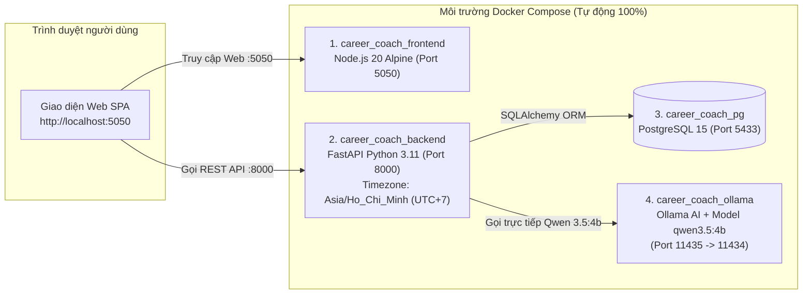

# 🌱 AI Career Coach - Hệ Thống Định Hướng Nghề Nghiệp Đa Ngành, Lập Lộ Trình Học Tập & Phỏng Vấn Thử AI

> **Đề án / Bài thi thực hành**: Ứng dụng Trí tuệ Nhân tạo (**LLM Qwen 3.5:4b qua Ollama** kết hợp **Hệ thống Trích xuất Kỹ năng Đa ngành Universal**) cùng **FastAPI**, **PostgreSQL 15** và **Gamification** hỗ trợ người học ở **tất cả các ngành nghề** phân tích khoảng trống kỹ năng (Skill Gap) từ CV & JD tự do, tự động lập lịch học theo thời gian rảnh (múi giờ Việt Nam `UTC+7`) và luyện phỏng vấn ngẫu nhiên đa vòng theo mô hình chuẩn **STAR**.
>
> **Đóng gói chuẩn Docker 100%**: Toàn bộ hệ thống gồm **4 thành phần (`career_coach_pg` + `career_coach_ollama` + `career_coach_backend` + `career_coach_frontend`)** đã được đóng gói hoàn chỉnh bằng `Dockerfile` và `docker-compose.yml`. Người chấm bài / người dùng tải về từ Git **không cần cài đặt Python, Node.js, PostgreSQL hay Ollama ngoài máy thật**, chỉ cần chạy duy nhất lệnh `docker compose up --build -d`.

---

## 📌 1. Giới thiệu tổng quan

**AI Career Coach** giải quyết bài toán định hướng nghề nghiệp và huấn luyện kỹ năng cho sinh viên / người đi làm ở mọi lĩnh vực thông qua quy trình khép kín 4 bước:
1. **Đánh giá năng lực hiện tại (Đa ngành nghề & Chống file rác)**: Trích xuất tự động kỹ năng chuyên môn, kỹ năng mềm và kinh nghiệm từ file CV PDF tải lên (chỉ chấp nhận `.pdf`, tự động phát hiện và chặn file rác không phải CV) hoặc chọn bộ hồ sơ mẫu đa lĩnh vực. Hỗ trợ nhận diện kỹ năng trên **15+ nhóm ngành lớn** (*CNTT/Phần mềm, Dữ liệu/BA, Tài chính/Kế toán/Kiểm toán, Luật/Pháp chế, F&B/Nhà hàng - Khách sạn, Marketing/Truyền thông, Nhân sự/HR, Kinh doanh/Sales, Logistics/Chuỗi cung ứng, Kỹ thuật/Sản xuất, Y dược, Giáo dục, Thiết kế/Sáng tạo*).
2. **Phân tích Độ khớp & Kết luận Chuyên sâu (Universal Skill-Gap & JD Analysis)**: So khớp hồ sơ với vị trí mẫu hoặc **Mô tả công việc (JD) dán tự do của bất kỳ ngành nào**. Chấm điểm theo công thức trọng số, vẽ biểu đồ Radar năng lực theo nhóm ngành, lưu lịch sử phân tích vào PostgreSQL và đưa ra **Báo cáo Kết luận & Đánh giá chuyên sâu** đa chiều.
3. **Lên lộ trình học tập Cá nhân hóa & Băm giờ thông minh (Smart Study Planner - Múi giờ `UTC+7`)**: Thiết kế các bài học nhúng đích danh từng kỹ năng còn thiếu (hoặc nâng cao chuyên môn thực chiến theo JD khi CV đã xuất sắc), tự động cắt nhỏ thời lượng bài học để lấp vừa khít các khung giờ rảnh thực tế của người học và mở khóa đúng giờ (`unlock_time` theo chuẩn giờ Việt Nam `Asia/Ho_Chi_Minh`).
4. **Luyện phỏng vấn Ngẫu nhiên Đa vòng & Chấm điểm STAR + Gamification**: Giả lập phòng phỏng vấn với 4 vòng (*Vòng Nhân sự HR, Vòng Chuyên môn Tech Lead, Vòng Văn hóa Culture Fit, Vòng Cuối Hiring Manager*). Mỗi lượt đều **sinh ngẫu nhiên bộ 3 câu hỏi mới không trùng lặp** với cách xưng hô chuẩn mực (*Tôi - bạn*), chấm điểm chi tiết (thang `1.0 – 10.0`), viết lại đáp án mẫu chuẩn **STAR**, lưu trữ vào Database và thưởng điểm **XP** để nuôi trồng **Mầm cây tri thức** qua 6 giai đoạn.

---

## 🌟 2. Các tính năng cốt lõi & Nâng cấp kỹ thuật đã hoàn thiện

| Phân hệ | Chi tiết tính năng |
| :--- | :--- |
| **1. Quản lý Tài khoản Bảo mật & Trích xuất CV PDF** | • Đăng ký / Đăng nhập tài khoản cá nhân: Kiểm tra chặt chẽ định dạng Email, độ dài & độ mạnh mật khẩu, **băm mật khẩu một chiều bằng thuật toán `SHA-256`** trước khi lưu vào Database.<br>• Tách biệt hoàn toàn ID hồ sơ mẫu (`9991`, `9992`, `9993`) với chuỗi ID tự tăng của người dùng thật để không bao giờ xảy ra xung đột khóa chính (`Primary Key`).<br>• Chỉ cho phép chọn file định dạng `.pdf` (`accept=".pdf"`), kiểm tra tính hợp lệ của CV (`is_cv`) và báo lỗi trực tiếp trên giao diện khi tải lên file rác.<br>• Đồng nhất ngôn ngữ kỹ năng: Tự động chuẩn hóa các kỹ năng mềm/kỹ năng chung sang Tiếng Việt cho CV Tiếng Việt, giữ nguyên thuật ngữ công nghệ/phần mềm quốc tế (Python, ReactJS, Docker, Excel, MISA...). |
| **2. Phân tích JD Tự Do Mọi Ngành & Kết luận Chuyên sâu** | • Hỗ trợ chọn JD mẫu đa ngành hoặc **dán trực tiếp bất kỳ JD thực tế nào vào ô JD Tự do** (giới hạn an toàn `maxlength="5000"` chống tràn bộ nhớ ngữ cảnh AI).<br>• Công thức chấm điểm định lượng: **50% Kỹ năng chuyên môn + 25% Mức độ hứng thú + 25% Kinh nghiệm thực tế**.<br>• Tự động lưu trữ toàn bộ thông tin vào 7 bảng Database (`profiles`, `jobs`, `analyses`, `study_tasks`, `streaks_and_reports`, `feedbacks`, `interviews`). |
| **3. Lộ trình Học tập Nhúng Đích Danh Kỹ Năng & Cập nhật Lịch rảnh** | • Tự động sinh danh sách bài học thực chiến **nhúng đích danh tên kỹ năng cần học vào tiêu đề bài học** (loại bỏ hoàn toàn các tiêu đề chung chung).<br>• **Cập nhật lịch rảnh giữ nguyên lộ trình (`/study-plan/update-schedule`)**: Đổi khung giờ rảnh và tự động phân bổ lại các bài học chưa hoàn thành mà không làm mất lộ trình, không mất bài đã học hay chuỗi Streak.<br>• Đồng bộ thời gian thực trên Dropdown chọn giờ học ngày hôm nay (`isToday`). |
| **4. Phỏng vấn Ngẫu nhiên Đa vòng (VI / EN) & Chấm điểm STAR** | • **Hỗ trợ 2 ngôn ngữ Tiếng Việt & Tiếng Anh**: Xưng hô chuẩn mực doanh nghiệp (*Tôi - bạn*), đóng vai giám khảo hỏi trực tiếp tự nhiên, không lặp lại góc độ câu hỏi.<br>• **Giao diện phòng thi thực chiến**: Đã loại bỏ khung gợi ý STAR trước khi nộp bài để đảm bảo tính khách quan; chỉ hiển thị điểm số, nhận xét chi tiết và đáp án mẫu chuẩn STAR sau khi ứng viên nộp câu trả lời (`maxlength="2000"`).<br>• Ép kiểu đầu ra `format='json'` cho toàn bộ các lời gọi `ollama.chat()` để đảm bảo độ ổn định 100%. |
| **5. Gamification & Thẻ Nghỉ Phép Thông Minh** | • **Quá trình nuôi cây gắn liền với lộ trình**: Tổng XP mục tiêu = `(Tổng số bài học × 50 XP) + (Số ngày của lộ trình × 25 XP tưới cây)` qua 6 giai đoạn phát triển.<br>• **Thẻ Phiếu Nghỉ Phép (1 lần / 1 tuần)**: Chỉ cho phép sử dụng khi ngày hôm đó **có lịch học theo đăng ký**; khi sử dụng sẽ tự động miễn và vô hiệu hóa (`status = "excused"`) các bài tập của ngày hôm đó để bảo lưu chuỗi Streak, đồng thời chống gian lận reset thẻ nghỉ phép khi tạo lại lộ trình. |

---

## 🏗️ 3. Kiến trúc hệ thống (4 Containers tự động hoàn toàn)



---

## 🚀 4. Hướng dẫn Biên dịch và Cài đặt (Compilation & Installation)

### Yêu cầu trước khi cài đặt
* Máy tính đã cài đặt và bật sẵn **[Docker Desktop](https://www.docker.com/products/docker-desktop/)** (đảm bảo Docker Engine đang ở trạng thái **Running**).
* **Không cần** cài đặt Python, Node.js, PostgreSQL hay Ollama bên ngoài máy thật.

### Bước 1: Tải mã nguồn từ Git về máy
Mở **Terminal**, **Command Prompt (CMD)** hoặc **PowerShell**, chạy lệnh:
```bash
git clone https://github.com/1305Thach2006/ccccc.git
cd ccccc
```
*(Nếu bạn đang đứng sẵn trong thư mục dự án `ai-career-coach`, bỏ qua bước `git clone`).*

### Bước 2: Biên dịch Docker Image và Khởi chạy toàn bộ hệ thống
Tại thư mục gốc của dự án (nơi có file `docker-compose.yml` và `Dockerfile`), chạy lệnh:
```bash
docker compose up --build -d
```

> **Giải thích quá trình biên dịch & khởi chạy**:
> * Cờ `--build` sẽ tự động biên dịch (build) mới 2 Docker Image từ mã nguồn:
>   1. **Backend Image** (từ `./Dockerfile`): Cài đặt Python 3.11-slim, múi giờ `Asia/Ho_Chi_Minh`, các thư viện trong `requirements.txt` và đóng gói `main.py`.
>   2. **Frontend Image** (từ `./front_end/Dockerfile`): Đóng gói giao diện tĩnh trên nền Node.js 20 Alpine (`server.js` tại cổng `5050`).
> * Khởi tạo container **PostgreSQL 15** (`career_coach_pg`) và tự động tạo đầy đủ 7 bảng dữ liệu.
> * Khởi tạo container **Ollama AI** (`career_coach_ollama`) và tự động tải model `qwen3.5:4b`.

*(Tùy chọn) Nếu muốn biên dịch riêng từng Dockerfile thủ công:*
```bash
# Biên dịch image cho Backend FastAPI
docker build -t career-coach-backend:latest .

# Biên dịch image cho Frontend Node.js
docker build -t career-coach-frontend:latest ./front_end
```

### Bước 3: Mở trình duyệt và sử dụng hệ thống
Sau khi lệnh báo `Started`, truy cập các địa chỉ sau:

| Thành phần | Đường dẫn truy cập | Mô tả chi tiết |
| :--- | :--- | :--- |
| **Giao diện Web chính (Frontend)** | **[http://localhost:5050](http://localhost:5050)** | Giao diện sử dụng đầy đủ các tính năng của ứng dụng |
| **Tài liệu API (Swagger UI)** | **[http://localhost:8000/docs](http://localhost:8000/docs)** | Giao diện kiểm thử trực tiếp toàn bộ REST API của Backend |
| **Kiểm tra trạng thái Backend** | **[http://localhost:8000/](http://localhost:8000/)** | Trả về thông điệp JSON xác nhận server đang hoạt động |
| **PostgreSQL Database** | `localhost:5433` | **User**: `admin` \| **Pass**: `secretpassword123` \| **DB**: `career_coach` |
| **Ollama AI Container** | `localhost:11435` | Cổng AI của Docker (ánh xạ ra cổng `11435` để không đụng cổng `11434` trên máy host) |

---

## 🤖 5. Hướng dẫn Kiểm tra Model AI (`qwen3.5:4b`) đã tải về và đang chạy chưa

Bạn có thể kiểm tra trạng thái của mô hình AI `qwen3.5:4b` bằng một trong các lệnh sau trên **PowerShell / Terminal**:

### 5.1. Kiểm tra Model AI bên trong Docker Container (`career_coach_ollama`)
```bash
# 1. Kiểm tra danh sách các model AI đã được tải về thành công trong Docker
docker exec -it career_coach_ollama ollama list
```
* **Kết quả mong đợi**: Xuất hiện dòng `qwen3.5:4b` kèm dung lượng (~2.7 GB). Nếu chưa thấy, tức là model đang trong quá trình tải về.

```bash
# 2. Kiểm tra xem model AI có đang được nạp và chạy trong RAM/VRAM hay không
docker exec -it career_coach_ollama ollama ps
```

```bash
# 3. Nếu mạng bị gián đoạn khiến model chưa tải xong, chạy lệnh sau để tải trực tiếp và xem thanh tiến trình %:
docker exec -it career_coach_ollama ollama pull qwen3.5:4b
```

### 5.2. Kiểm tra Model AI qua giao thức HTTP API
* **Trên Windows PowerShell**:
  ```powershell
  Invoke-RestMethod -Uri "http://localhost:11435/api/tags"
  ```
* **Trên CMD / Linux / macOS**:
  ```bash
  curl http://localhost:11435/api/tags
  ```

### 5.3. Kiểm tra nếu bạn dùng Ollama cài trực tiếp ngoài máy thật (Local)
```bash
# Xem model đã tải trên máy thật
ollama list

# Xem model đang chạy trên máy thật
ollama ps
```

---

## 📋 6. Hướng dẫn Kiểm tra Log hệ thống (Check Logs)

Khi vận hành hoặc chấm điểm, bạn có thể theo dõi nhật ký hoạt động (log) theo thời gian thực của toàn bộ hệ thống hoặc từng dịch vụ riêng biệt:

```bash
# 1. Kiểm tra trạng thái hoạt động (Running / Healthy) của cả 4 containers
docker compose ps

# 2. Xem log trực tiếp (real-time) của TẤT CẢ các dịch vụ cùng lúc
docker compose logs -f

# 3. Xem log riêng của Backend FastAPI (xem dữ liệu JSON AI trả về, các request API và lỗi nếu có)
docker compose logs -f backend
# Hoặc:
docker logs -f career_coach_backend

# 4. Xem log riêng của AI Server Ollama (xem tiến độ tải model qwen3.5:4b và tốc độ sinh token)
docker compose logs -f ollama
# Hoặc:
docker logs -f career_coach_ollama

# 5. Xem log riêng của Frontend Web Server (Node.js cổng 5050)
docker compose logs -f frontend
# Hoặc:
docker logs -f career_coach_frontend

# 6. Xem log riêng của Cơ sở dữ liệu PostgreSQL
docker compose logs -f postgres_db
# Hoặc:
docker logs -f career_coach_pg

# 7. Chỉ xem 100 dòng log gần nhất của Backend mà không treo terminal
docker compose logs --tail=100 backend
```
*(Mẹo: Nhấn tổ hợp phím `Ctrl + C` để thoát khỏi chế độ xem log `-f` mà không làm tắt container).*

---

## 🗑️ 7. Hướng dẫn Gỡ cài đặt & Dọn dẹp hệ thống (Uninstallation)

Tùy theo nhu cầu sau khi sử dụng hoặc chấm bài xong, bạn có thể gỡ cài đặt theo 3 mức độ dưới đây:

### Mức 1: Dừng và gỡ Container (Giữ lại dữ liệu Database và Model AI đã tải)
Khi muốn tắt hệ thống để giải phóng RAM nhưng lần sau bật lên không phải tải lại model AI:
```bash
docker compose down
```

### Mức 2: Gỡ cài đặt Container + Xóa sạch dữ liệu Database & Volume (Reset dữ liệu về mới tinh)
```bash
docker compose down -v
```

### Mức 3: Gỡ cài đặt HOÀN TOÀN (Xóa Container + Xóa Volume + Xóa toàn bộ Docker Images + Xóa thư mục code)
Thực hiện lần lượt các bước sau để đưa máy tính về trạng thái ban đầu:

#### Bước 1: Xóa toàn bộ Container, Volume và Docker Images đã biên dịch
```bash
docker compose down -v --rmi all
```
*(Nếu trên máy còn container cũ tạo thủ công, chạy thêm: `docker rm -f career_coach_frontend career_coach_backend career_coach_pg career_coach_ollama`).*

#### Bước 2: Xóa thư mục mã nguồn dự án
* **Trên Windows (PowerShell)**:
  ```powershell
  cd ..
  Remove-Item -Recurse -Force ccccc
  ```
* **Trên Windows (CMD)**:
  ```cmd
  cd ..
  rmdir /s /q ccccc
  ```
* **Trên Linux / macOS / Git Bash**:
  ```bash
  cd ..
  rm -rf ccccc
  ```

---

## 📡 8. Danh mục 20 API Endpoints trong hệ thống

| Phương thức | Endpoint | Chức năng xử lý |
| :---: | :--- | :--- |
| `POST` | `/auth/register` | Đăng ký tài khoản mới (kiểm tra Email, độ mạnh mật khẩu & băm `SHA-256`) |
| `POST` | `/auth/login` | Đăng nhập hệ thống bằng mật khẩu băm `SHA-256` và đồng bộ hồ sơ cá nhân |
| `GET` | `/auth/verify/{profile_id}` | Xác thực phiên đăng nhập lưu trong trình duyệt |
| `POST` | `/profiles/extract-cv/` | **[AI + Universal NLP]** Kiểm tra CV hợp lệ (`is_cv`), bóc tách kỹ năng chuyên ngành, kỹ năng mềm & kinh nghiệm từ PDF |
| `POST` | `/jobs/extract-advanced/` | **[AI + Universal NLP]** Trích xuất kỹ năng chuyên môn kèm bằng chứng từ Mô tả công việc (JD) và lưu vào bảng `jobs` |
| `POST` | `/analyses/match/{profile_id}/{role_id}` | **[AI + Thuật toán]** Phân tích độ khớp CV - JD, vẽ biểu đồ Radar, lưu vào bảng `analyses` & sinh Kết luận chuyên sâu |
| `POST` | `/analyses/feedback` | Lưu đánh giá phản hồi của người dùng về kết quả phân tích vào bảng `feedbacks` |
| `GET` | `/analyses/history/{profile_id}` | Truy vấn lịch sử các lần phân tích độ khớp CV - JD từ bảng `analyses` |
| `POST` | `/study-plan/generate` | **[AI + Băm giờ]** Sinh lộ trình học tập nhúng đích danh tên kỹ năng, chia nhỏ theo lịch rảnh (`UTC+7`) |
| `POST` | `/study-plan/update-schedule` | **[Cập nhật lịch rảnh]** Đổi lịch rảnh và xếp lại các bài chưa học nhưng **giữ nguyên lộ trình, bài đã học & Streak** |
| `GET` | `/study-plan/schedules/{profile_id}` | Lấy danh sách các khung giờ rảnh đã lưu của học viên |
| `GET` | `/study-plan/tasks/{profile_id}` | Lấy danh sách các bài học trong lộ trình đã lưu của học viên |
| `POST` | `/study-plan/complete-task` | Hoàn thành bài học (kiểm tra giờ mở khóa `UTC+7`), cộng +50 XP & tính Streak |
| `GET` | `/gamification/{profile_id}` | Lấy dữ liệu giai đoạn mầm cây, XP, chuỗi Streak, Phiếu nghỉ phép và chỉ số kỷ luật |
| `POST` | `/gamification/water-plant/{profile_id}` | Tưới nước chăm sóc mầm cây mỗi ngày một lần (+25 XP) |
| `POST` | `/gamification/use-leave-pass/{profile_id}` | Sử dụng **Thẻ Nghỉ Phép** (chỉ cho phép vào ngày có lịch học & tự động miễn bài tập hôm đó) |
| `POST` | `/interview/generate` | **[AI + Random Engine]** Sinh ngẫu nhiên bộ 3 câu hỏi phỏng vấn mới không trùng lặp (`vi` / `en`, `format='json'`) |
| `POST` | `/interview/submit-and-evaluate/{question_id}` | **[AI Giám khảo]** Chấm điểm câu trả lời phỏng vấn (`1.0 – 10.0`), sửa bài chuẩn STAR & lưu vào bảng `interviews` |
| `GET` | `/interview/history/{profile_id}` | Truy vấn lịch sử các câu trả lời phỏng vấn và điểm số từ bảng `interviews` |
| `DELETE` | `/system/reset-database/` | Xóa và khởi tạo lại toàn bộ bảng trong Database để phục vụ kiểm thử |

---

## 📂 9. Cấu trúc thư mục dự án

```text
ai-career-coach/
├── front_end/
│   ├── Dockerfile             # Dockerfile đóng gói giao diện Frontend (Node.js 20 Alpine - Cổng 5050)
│   ├── index.html             # Giao diện chính của ứng dụng (Single Page Application)
│   ├── style.css              # Hệ thống giao diện & hiệu ứng chuyển động
│   ├── app.js                 # Logic xử lý phía Client, kiểm tra đầu vào, đồ họa SVG mầm cây & gọi API
│   ├── store.js               # Quản lý State & tự động đồng bộ LocalStorage / SessionStorage
│   ├── data.js                # Dữ liệu mẫu CV & Vị trí công việc đa ngành nghề
│   ├── roles.json             # Danh mục ngành nghề mẫu
│   ├── sample-profiles.json   # Hồ sơ sinh viên mẫu phục vụ chấm thử nhanh (ID 9991..9993)
│   └── server.js              # HTTP Server Node.js phục vụ giao diện tại cổng 5050
├── Dockerfile                 # Dockerfile chính đóng gói Backend FastAPI (Python 3.11 - Cổng 8000, UTC+7)
├── docker-compose.yml         # Điều phối trọn bộ 4 container: Postgres + Ollama AI + Backend + Frontend
├── docker-compose.gpu.yml     # Cấu hình mở rộng cho phép Ollama sử dụng GPU rời NVIDIA
├── requirements.txt           # Danh sách thư viện Python cần thiết
├── .env.example               # File mẫu cấu hình biến môi trường (Ports, DB, Ollama)
├── .dockerignore              # Loại trừ file thừa khi biên dịch Docker image
├── .gitignore                 # Loại trừ file rác (__pycache__, .env...) khi đẩy lên GitHub
├── run.bat / stop.bat         # Tiện ích khởi chạy & dừng nhanh 1-Click trên Windows
├── run.sh                     # Tiện ích khởi chạy nhanh trên Linux / macOS
├── README.md                  # Tài liệu hướng dẫn biên dịch, cài đặt, kiểm tra model AI, check log & liên hệ
├── models.py                  # Định nghĩa 7 bảng cơ sở dữ liệu SQLAlchemy (PostgreSQL)
├── schemas.py                 # Định nghĩa Pydantic Schemas kiểm tra dữ liệu đầu vào/đầu ra
├── database.py                # Cấu hình kết nối PostgreSQL qua SQLAlchemy
└── main.py                    # Mã nguồn Backend FastAPI tổng hợp toàn bộ nghiệp vụ của hệ thống
```

---

## 💬 10. Kênh Công khai để Giao tiếp, Liên lạc & Hỗ trợ Kỹ thuật

Dự án mở rộng các kênh giao tiếp công khai để giảng viên, hội đồng chấm thi và người dùng có thể trao đổi, báo cáo lỗi (Bug Report), đóng góp mã nguồn hoặc nhận hỗ trợ kỹ thuật trực tiếp:

* 🌐 **Kho mã nguồn chính thức (GitHub Repository)**:  
  [https://github.com/1305Thach2006/ccccc](https://github.com/1305Thach2006/ccccc)
* 🐛 **Kênh Báo lỗi & Yêu cầu Tính năng Công khai (GitHub Issues)**:  
  [https://github.com/1305Thach2006/ccccc/issues](https://github.com/1305Thach2006/ccccc/issues)  
  *(Mọi vấn đề về cài đặt Docker, lỗi model AI hoặc góp ý giao diện có thể tạo Issue trực tiếp tại đây để nhóm phát triển phản hồi công khai).*
* 🤝 **Kênh Đóng góp & Thảo luận Mã nguồn (GitHub Pull Requests)**:  
  [https://github.com/1305Thach2006/ccccc/pulls](https://github.com/1305Thach2006/ccccc/pulls)
* 📖 **Cổng Tài liệu & Kiểm thử API Công khai (Swagger UI Local)**:  
  [http://localhost:8000/docs](http://localhost:8000/docs) *(Hoạt động ngay sau khi bật container Backend)*.
* 📧 **Liên hệ trực tiếp Nhóm phát triển (Maintainer)**:  
  * **GitHub Profile**: [@1305Thach2006](https://github.com/1305Thach2006)  
  * **Thời gian phản hồi hỗ trợ**: 24/7 qua GitHub Issues của dự án.
