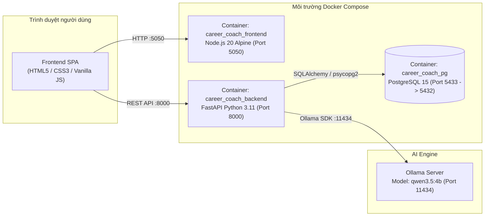

# 🌱 AI Career Coach - Hệ Thống Định Hướng Nghề Nghiệp, Lập Lộ Trình Học Tập & Phỏng Vấn Thử AI

> **Đề án / Bài thi thực hành**: Ứng dụng Trí tuệ Nhân tạo Cục bộ (**Local LLM - Qwen 3.5:4b qua Ollama**) kết hợp **FastAPI**, **PostgreSQL** và **Gamification** nhằm hỗ trợ sinh viên phân tích khoảng trống kỹ năng (Skill Gap), tự động lập lịch học theo thời gian rảnh và luyện phỏng vấn theo mô hình chuẩn **STAR**.

---

## 📌 1. Giới thiệu tổng quan

**AI Career Coach** giải quyết bài toán mông lung nghề nghiệp của sinh viên thông qua quy trình khép kín 4 bước:
1. **Đánh giá năng lực hiện tại**: Trích xuất kỹ năng từ CV tự do bằng AI hoặc chọn bộ hồ sơ mẫu đa ngành (CNTT, Kinh tế - Tài chính, Luật).
2. **Phân tích độ khớp công việc (Job Matching & Skill-Gap)**: So khớp hồ sơ với Mô tả công việc (JD), chấm điểm theo công thức trọng số và trực quan hóa bằng biểu đồ Radar.
3. **Lên lộ trình học tập & Băm giờ thông minh (Smart Study Planner)**: AI thiết kế các bài học bù đắp đúng các kỹ năng còn thiếu, sau đó thuật toán Python tự động cắt nhỏ thời lượng bài học để lấp vừa khít các khung giờ rảnh thực tế của người học.
4. **Luyện phỏng vấn STAR & Gamification**: Giả lập phòng phỏng vấn với AI đóng vai nhà tuyển dụng, chấm điểm chi tiết từng câu trả lời và quy đổi thành điểm kinh nghiệm (**XP**) để nuôi trồng **Mầm cây tri thức** qua 6 giai đoạn phát triển.

---

## ✨ 2. Các tính năng nổi bật

| Phân hệ | Chi tiết tính năng |
| :--- | :--- |
| **1. Quản lý Hồ sơ & Trích xuất CV bằng AI** | • Đăng ký / Đăng nhập tài khoản cá nhân.<br>• Bóc tách tự động Tên, Email, Kỹ năng chuyên môn từ văn bản CV thô bằng mô hình `qwen3.5:4b`.<br>• Tích hợp sẵn dữ liệu hồ sơ mẫu đa lĩnh vực (CNTT, Kinh tế, Luật) để kiểm thử nhanh. |
| **2. Phân tích Độ phù hợp & Khoảng trống Kỹ năng** | • Hỗ trợ chọn vị trí công việc có sẵn hoặc dán trực tiếp **JD tự do** (AI tự động trích xuất yêu cầu kỹ năng).<br>• Công thức tính điểm toàn diện: **50% Kỹ năng chuyên môn + 25% Mức độ yêu thích + 25% Kinh nghiệm thực tế**.<br>• Liệt kê chi tiết các kỹ năng đã đạt và kỹ năng còn thiếu (Gaps) kèm lý do cụ thể. |
| **3. Lộ trình Học tập & Thuật toán Băm giờ (Time-Slicing)** | • AI tự động sinh danh sách bài học đảm bảo bao phủ 100% các kỹ năng bị thiếu.<br>• **Thuật toán băm giờ tự động**: Chia nhỏ bài học dài thành nhiều phần (`Phần 1`, `Phần 2`...) khớp với từng ca rảnh sinh viên đã đăng ký; các bài vượt quá quỹ thời gian rảnh được đưa vào trạng thái *"Chờ xếp lịch"*.<br>• **Cơ chế khóa theo thời gian thực (`unlock_time`)**: Chỉ cho phép bấm hoàn thành bài học khi đã đến đúng khung giờ học đã lên lịch. |
| **4. Phỏng vấn Giả lập theo Mô hình STAR** | • AI sinh bộ 3 câu hỏi phỏng vấn phân tầng độ khó (*Chuyên môn - Tình huống - Kỹ năng mềm*) bám sát vị trí ứng tuyển và điểm yếu của ứng viên kèm gợi ý khung **STAR** (*Situation - Task - Action - Result*).<br>• AI đóng vai giám khảo chấm điểm (thang 1.0 – 10.0), nhận xét ưu/nhược điểm và viết lại câu trả lời mẫu chuẩn STAR. |
| **5. Gamification (Nuôi Mầm Cây & Chuỗi Streak)** | • **6 giai đoạn phát triển cây**: *Hạt giống → Nảy mầm → Phát triển thân → Phân cành → Ra lá → Kết trái* (tính theo % tiến độ hoàn thành lộ trình).<br>• Theo dõi **Chuỗi ngày học liên tiếp (Streak)**, **Tưới nước hằng ngày (+25 XP)**, điểm thưởng hoàn thành bài học (+50 XP) và **Chỉ số Kỷ luật tuần (%)**. |

---

## 🏗️ 3. Kiến trúc hệ thống & Công nghệ sử dụng



* **Backend**: Python 3.11, FastAPI, Uvicorn, SQLAlchemy ORM, Pydantic, Psycopg2.
* **Frontend**: Vanilla JavaScript (ES6+), HTML5, CSS3, SVG Animation, Web Audio API, Node.js Static HTTP Server.
* **Cơ sở dữ liệu**: PostgreSQL 15 (lưu trữ bền vững qua Docker Volume `pgdata`).
* **Mô hình AI**: Ollama (`qwen3.5:4b`) chạy cục bộ, đảm bảo quyền riêng tư dữ liệu CV và không tốn phí API.
* **Đóng gói & Triển khai**: Docker, Docker Compose (hỗ trợ cả chế độ tiêu chuẩn và chế độ GPU NVIDIA).

---

## 🚀 4. Hướng dẫn cài đặt và khởi chạy chi tiết (Từ A - Z)

Để chạy dự án, bạn chỉ cần thực hiện lần lượt **3 bước** dưới đây:

### Bước 1: Chuẩn bị môi trường
1. Cài đặt và mở **[Docker Desktop](https://www.docker.com/products/docker-desktop/)** (đảm bảo Docker đang ở trạng thái *Running*).
2. Cài đặt **[Ollama](https://ollama.com/download)** trên máy tính và tải mô hình `qwen3.5:4b` bằng cách mở Terminal / PowerShell gõ:
   ```bash
   ollama pull qwen3.5:4b
   ```
   *(Lưu ý: Nếu máy bạn có card rời NVIDIA và muốn chạy luôn Ollama bên trong Docker mà không cần cài Ollama ngoài máy thật, hãy xem **Cách 3** ở Bước 3).*

---

### Bước 2: Tải mã nguồn dự án về máy
```bash
git clone https://github.com/1305Thach2006/ccccc.git
cd ccccc
```

---

### Bước 3: Khởi chạy hệ thống bằng Docker (Chọn 1 trong 3 cách)

#### ✅ Cách 1: Khởi chạy bằng 1 lệnh Docker Compose duy nhất (Khuyên dùng)
Tại thư mục gốc của dự án, chạy lệnh:
```bash
docker compose up --build -d
```
> **Giải thích**: Chỉ với 1 lệnh này, Docker sẽ tự động:
> 1. Tải và khởi tạo cơ sở dữ liệu **PostgreSQL 15** (cổng `5433`) cùng đầy đủ các bảng dữ liệu.
> 2. Đóng gói và khởi chạy **Backend FastAPI** (cổng `8000`), tự động kết nối vào Database và Ollama.
> 3. Đóng gói và khởi chạy **Frontend Web Server** (cổng `5050`).

#### ✅ Cách 2: Chạy tự động 1-Click bằng Script (Tự động xử lý trùng cổng)
* **Trên Windows**: Nhấp đúp chuột vào file **`run.bat`** hoặc gõ trong PowerShell:
  ```powershell
  .\run.bat
  ```
  *(Script sẽ tự động tạo file `.env` từ `.env.example`, tự động giải phóng cổng `5050` nếu đang bị ứng dụng khác chiếm dụng, chạy `docker compose up --build -d` và tự mở trình duyệt).*
* **Trên Linux / macOS**:
  ```bash
  chmod +x run.sh
  ./run.sh
  ```

#### ✅ Cách 3: Chạy trọn bộ kèm Container Ollama GPU (Dành cho máy có GPU NVIDIA)
Nếu muốn đóng gói cả Ollama chạy bằng card đồ họa rời bên trong Docker:
```bash
docker compose -f docker-compose.gpu.yml up --build -d
```

---

### Bước 4: Truy cập và kiểm thử ứng dụng

Sau khi lệnh chạy hoàn tất (khoảng 10–30 giây), mở trình duyệt và truy cập:

| Thành phần | Đường dẫn truy cập | Mô tả |
| :--- | :--- | :--- |
| 🌐 **Giao diện Web (Frontend)** | **[http://localhost:5050](http://localhost:5050)** | Giao diện chính dành cho người dùng cuối |
| 📄 **Tài liệu API (Swagger UI)** | **[http://localhost:8000/docs](http://localhost:8000/docs)** | Giao diện kiểm thử trực tiếp các API Backend |
| 🩺 **Kiểm tra trạng thái Backend** | **[http://localhost:8000/](http://localhost:8000/)** | Trả về JSON xác nhận Backend đang hoạt động |
| 🗄️ **PostgreSQL Database** | `localhost:5433` | **User**: `admin` \| **Pass**: `secretpassword123` \| **DB**: `career_coach` |

---

## 🔌 5. Danh mục API Endpoints chính

| Phương thức | Endpoint | Chức năng |
| :---: | :--- | :--- |
| `POST` | `/auth/register` | Đăng ký tài khoản học viên mới & khởi tạo chậu cây Gamification |
| `POST` | `/auth/login` | Đăng nhập hệ thống |
| `POST` | `/profiles/extract-cv/` | Dùng AI (`qwen3.5:4b`) trích xuất thông tin và kỹ năng từ văn bản CV |
| `POST` | `/jobs/extract-advanced/` | Dùng AI trích xuất danh sách kỹ năng chuyên môn kèm bằng chứng từ JD |
| `POST` | `/analyses/match/{profile_id}/{role_id}` | Phân tích độ khớp CV - JD, trả về điểm số, biểu đồ Radar và khoảng trống kỹ năng |
| `POST` | `/study-plan/generate` | AI tạo bài học bù đắp kỹ năng thiếu & thuật toán Python băm giờ theo lịch rảnh |
| `GET` | `/study-plan/tasks/{profile_id}` | Lấy danh sách lộ trình học tập đã lưu của tài khoản |
| `POST` | `/study-plan/complete-task` | Đánh dấu hoàn thành bài học, cộng XP, tính chuỗi Streak và cập nhật giai đoạn cây |
| `GET` | `/gamification/{profile_id}` | Lấy thông tin mầm cây, XP, chuỗi Streak và chỉ số kỷ luật tuần |
| `POST` | `/gamification/water-plant/{profile_id}` | Tưới nước cho cây mỗi ngày (+25 XP) |
| `POST` | `/interview/generate` | AI sinh 3 câu hỏi phỏng vấn theo vị trí & điểm yếu kèm gợi ý khung STAR |
| `POST` | `/interview/submit-and-evaluate/{question_id}` | AI chấm điểm câu trả lời phỏng vấn (1–10), nhận xét và thưởng XP |
| `DELETE` | `/system/reset-database/` | Làm sạch và khởi tạo lại toàn bộ bảng trong Database để kiểm thử |

---

## 🛠️ 6. Các lệnh quản lý Docker & Xử lý sự cố (Troubleshooting)

### Quản lý Container hằng ngày
```bash
# Kiểm tra danh sách các container đang chạy
docker compose ps

# Xem nhật ký (logs) hoạt động của Backend và AI theo thời gian thực
docker compose logs -f backend

# Dừng toàn bộ hệ thống (hoặc chạy file stop.bat trên Windows)
docker compose down

# Dừng hệ thống và xóa sạch dữ liệu Database để làm mới từ đầu
docker compose down -v
```

### Xử lý lỗi thường gặp

1. **Lỗi trùng cổng `5050` (`bind: Only one usage of each socket address is normally permitted`)**:
   * **Nguyên nhân**: Cổng `5050` đang bị một tiến trình Node.js cũ hoặc container khác chiếm giữ.
   * **Cách khắc phục**: Chạy file `.\run.bat` (script sẽ tự động tìm và tắt tiến trình chiếm cổng `5050`), hoặc chạy lệnh sau trong PowerShell:
     ```powershell
     Stop-Process -Id (Get-NetTCPConnection -LocalPort 5050).OwningProcess -Force
     docker compose up --build -d
     ```
   * Hoặc mở file `.env` (tạo từ `.env.example`) và đổi `FRONTEND_PORT=5055` để chuyển giao diện sang cổng `5055`.

2. **Lỗi AI không phản hồi khi phân tích JD / Phỏng vấn**:
   * Đảm bảo ứng dụng **Ollama** đang bật trên máy và đã tải xong model bằng lệnh `ollama pull qwen3.5:4b`.

---

## 📂 7. Cấu trúc thư mục dự án

```text
ai-career-coach/
├── front_end/
│   ├── Dockerfile             # Dockerfile đóng gói giao diện Frontend (Node.js 20 Alpine)
│   ├── index.html             # Giao diện chính của ứng dụng (Single Page Application)
│   ├── style.css              # Hệ thống giao diện & hiệu ứng chuyển động
│   ├── app.js                 # Logic xử lý phía Client, đồ họa SVG mầm cây, âm thanh & gọi API
│   ├── store.js               # Quản lý State & tự động đồng bộ LocalStorage / SessionStorage
│   ├── data.js                # Dữ liệu mẫu CV & Vị trí công việc đa ngành
│   ├── roles.json             # Danh mục ngành nghề mẫu (CNTT, Kinh tế, Luật)
│   ├── sample-profiles.json   # Hồ sơ sinh viên mẫu phục vụ chấm thử nhanh
│   └── server.js              # HTTP Server Node.js phục vụ giao diện tại cổng 5050
├── Dockerfile                 # Dockerfile chính đóng gói Backend FastAPI (Python 3.11 - Cổng 8000)
├── docker-compose.yml         # Điều phối trọn bộ PostgreSQL + Backend + Frontend
├── docker-compose.gpu.yml     # Điều phối trọn bộ kèm container Ollama sử dụng GPU NVIDIA
├── requirements.txt           # Danh sách thư viện Python cần thiết
├── .env.example               # File mẫu cấu hình biến môi trường (Ports, DB, Ollama)
├── .gitattributes             # Chuẩn hóa ký tự xuống dòng LF/CRLF giữa Windows và Linux/macOS
├── .dockerignore              # Loại trừ file thừa khi build Docker image
├── .gitignore                 # Loại trừ file rác (__pycache__, .env...) khi đẩy lên GitHub
├── run.bat                    # Script khởi chạy tự động 1-Click trên Windows
├── stop.bat                   # Script dừng toàn bộ container trên Windows
├── run.sh                     # Script khởi chạy tự động trên Linux / macOS
├── README.md                  # Tài liệu hướng dẫn chi tiết dự án
└── main.py                    # Mã nguồn Backend FastAPI + Thuật toán xếp lịch + AI + Gamification
```
