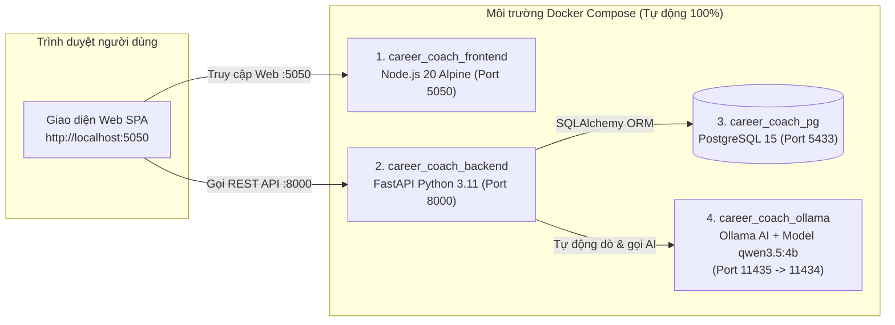

# 🌱 AI Career Coach - Hệ Thống Định Hướng Nghề Nghiệp, Lập Lộ Trình Học Tập & Phỏng Vấn Thử AI

> **Đề án / Bài thi thực hành**: Ứng dụng Trí tuệ Nhân tạo (**LLM Qwen 3.5:4b qua Ollama**) kết hợp **FastAPI**, **PostgreSQL 15** và **Gamification** nhằm hỗ trợ sinh viên phân tích khoảng trống kỹ năng (Skill Gap), tự động lập lịch học theo thời gian rảnh và luyện phỏng vấn theo mô hình chuẩn **STAR**.
>
> **Đặc điểm nổi bật khi triển khai**: Toàn bộ hệ thống gồm **4 thành phần (Database + AI Server Ollama + Backend + Frontend)** đã được đóng gói **100% bên trong Docker**. Người chấm bài / người dùng tải về từ GitHub **không cần cài đặt Python, Node.js, PostgreSQL hay Ollama ngoài máy thật**, chỉ cần chạy duy nhất lệnh `docker compose up --build -d`.

---

## 📌 1. Giới thiệu tổng quan

**AI Career Coach** giải quyết bài toán định hướng nghề nghiệp của sinh viên thông qua quy trình khép kín 4 bước:
1. **Đánh giá năng lực hiện tại**: Trích xuất kỹ năng từ CV tự do bằng AI hoặc chọn bộ hồ sơ mẫu đa ngành (CNTT, Kinh tế - Tài chính, Luật).
2. **Phân tích độ khớp công việc (Job Matching & Skill-Gap)**: So khớp hồ sơ với Mô tả công việc (JD), chấm điểm theo công thức trọng số và trực quan hóa bằng biểu đồ Radar.
3. **Lên lộ trình học tập & Băm giờ thông minh (Smart Study Planner)**: AI thiết kế các bài học bù đắp đúng các kỹ năng còn thiếu, sau đó thuật toán Python tự động cắt nhỏ thời lượng bài học để lấp vừa khít các khung giờ rảnh thực tế của người học.
4. **Luyện phỏng vấn STAR & Gamification**: Giả lập phòng phỏng vấn với AI đóng vai nhà tuyển dụng, chấm điểm chi tiết từng câu trả lời và quy đổi thành điểm kinh nghiệm (**XP**) để nuôi trồng **Mầm cây tri thức** qua 6 giai đoạn phát triển.

---

## ✨ 2. Các tính năng cốt lõi

| Phân hệ | Chi tiết tính năng |
| :--- | :--- |
| **1. Quản lý Hồ sơ & Trích xuất CV bằng AI** | • Đăng ký / Đăng nhập tài khoản cá nhân.<br>• Bóc tách tự động Tên, Email, Kỹ năng chuyên môn từ văn bản CV thô bằng mô hình `qwen3.5:4b`.<br>• Tích hợp sẵn dữ liệu hồ sơ mẫu đa lĩnh vực (CNTT, Kinh tế, Luật) để kiểm thử nhanh. |
| **2. Phân tích Độ phù hợp & Khoảng trống Kỹ năng** | • Hỗ trợ chọn vị trí công việc có sẵn hoặc dán trực tiếp **JD tự do** (AI tự động trích xuất yêu cầu kỹ năng).<br>• Công thức tính điểm toàn diện: **50% Kỹ năng chuyên môn + 25% Mức độ yêu thích + 25% Kinh nghiệm thực tế**.<br>• Liệt kê chi tiết các kỹ năng đã đạt và kỹ năng còn thiếu (Gaps) kèm lý do cụ thể. |
| **3. Lộ trình Học tập & Thuật toán Băm giờ (Time-Slicing)** | • AI tự động sinh danh sách bài học đảm bảo bao phủ 100% các kỹ năng bị thiếu.<br>• **Thuật toán băm giờ tự động**: Chia nhỏ bài học dài thành nhiều phần (`Phần 1`, `Phần 2`...) khớp với từng ca rảnh sinh viên đã đăng ký; các bài vượt quá quỹ thời gian rảnh được đưa vào trạng thái *"Chờ xếp lịch"*.<br>• **Cơ chế khóa theo thời gian thực (`unlock_time`)**: Chỉ cho phép bấm hoàn thành bài học khi đã đến đúng khung giờ học đã lên lịch. |
| **4. Phỏng vấn Giả lập theo Mô hình STAR** | • AI sinh bộ 3 câu hỏi phỏng vấn phân tầng độ khó (*Chuyên môn - Tình huống - Kỹ năng mềm*) bám sát vị trí ứng tuyển và điểm yếu của ứng viên kèm gợi ý khung **STAR** (*Situation - Task - Action - Result*).<br>• AI đóng vai giám khảo chấm điểm (thang 1.0 – 10.0), nhận xét ưu/nhược điểm và viết lại câu trả lời mẫu chuẩn STAR. |
| **5. Gamification (Nuôi Mầm Cây & Chuỗi Streak)** | • **6 giai đoạn phát triển cây**: *Hạt giống → Nảy mầm → Phát triển thân → Phân cành → Ra lá → Kết trái* (tính theo % tiến độ hoàn thành lộ trình).<br>• Theo dõi **Chuỗi ngày học liên tiếp (Streak)**, **Tưới nước hằng ngày (+25 XP)**, điểm thưởng hoàn thành bài học (+50 XP) và **Chỉ số Kỷ luật tuần (%)**. |

---

## 🏗️ 3. Kiến trúc hệ thống (4 Containers tự động hoàn toàn)



> **Cơ chế kết nối AI thông minh (`_smart_ollama_chat` trong `main.py`)**:
> * Nếu máy tính của bạn **đã cài sẵn Ollama và đã tải `qwen3.5:4b`**, Backend sẽ ưu tiên kết nối ngay với Ollama trên máy thật để phản hồi tức thì.
> * Nếu máy tính mới tải từ GitHub về **chưa cài Ollama hoặc chưa có model `qwen3.5:4b`**, hệ thống sẽ tự động chuyển sang dùng container **`career_coach_ollama`** đi kèm bên trong Docker và tự động tải model `qwen3.5:4b` về chạy.

---

## 🚀 4. Hướng dẫn cài đặt và chạy dự án từ GitHub (Từng bước chi tiết)

### Yêu cầu duy nhất trước khi chạy
* Máy tính đã cài đặt và mở sẵn **[Docker Desktop](https://www.docker.com/products/docker-desktop/)** (đảm bảo biểu tượng con cá voi Docker ở góc màn hình đang ở trạng thái **Running**).
* **Không cần** cài Python, **không cần** cài Node.js, **không cần** cài PostgreSQL.

---

### Bước 1: Tải mã nguồn từ GitHub về máy
Mở **Terminal** hoặc **PowerShell**, chạy lệnh:
```bash
git clone https://github.com/1305Thach2006/ccccc.git
cd ccccc
```

---

### Bước 2: Khởi chạy toàn bộ hệ thống bằng 1 lệnh duy nhất
Tại thư mục dự án, chạy lệnh:
```bash
docker compose up --build -d
```

*(💡 **Ghi chú**: Bạn **không bắt buộc** phải dùng `run.bat` hay `run.sh`. Chỉ cần đúng 1 lệnh `docker compose up --build -d` ở trên là đủ! Các file `run.bat` / `run.sh` chỉ là tiện ích phụ nếu bạn muốn nhấp đúp chuột thay vì gõ lệnh).*

---

### Bước 3: Chờ tải mô hình AI `qwen3.5:4b` (Chỉ mất vài phút ở lần chạy đầu tiên)

Nếu máy tính của bạn **mới tải dự án về lần đầu và chưa từng có mô hình AI `qwen3.5:4b`** (dung lượng khoảng ~2.5 GB), container `career_coach_ollama` sẽ tự động tải mô hình này ở chế độ chạy ngầm.

Để xem tiến trình tải mô hình AI đã đạt bao nhiêu phần trăm (%), bạn gõ lệnh sau vào Terminal:
```bash
docker logs -f career_coach_ollama
```
* Khi màn hình hiện `pulling ... 100%` và báo **`success`**, nghĩa là mô hình AI đã sẵn sàng 100%!
* Bạn nhấn tổ hợp phím **`Ctrl + C`** để thoát khỏi màn hình xem log (container vẫn tiếp tục chạy bình thường).
* *(Từ những lần chạy sau trở đi, mô hình đã được lưu vĩnh viễn trong Docker Volume `ollama_data` nên hệ thống sẽ dùng được ngay lập tức mà không cần tải lại).*

---

### Bước 4: Mở trình duyệt và sử dụng

Sau khi khởi chạy xong, bạn mở trình duyệt web và truy cập theo bảng dưới đây:

| Thành phần | Đường dẫn truy cập | Mô tả chi tiết |
| :--- | :--- | :--- |
| 🌐 **Giao diện Web chính (Frontend)** | **[http://localhost:5050](http://localhost:5050)** | Giao diện sử dụng đầy đủ các tính năng của ứng dụng |
| 📄 **Tài liệu API (Swagger UI)** | **[http://localhost:8000/docs](http://localhost:8000/docs)** | Giao diện kiểm thử trực tiếp các API của Backend |
| 🩺 **Kiểm tra trạng thái Backend** | **[http://localhost:8000/](http://localhost:8000/)** | Trả về thông điệp JSON xác nhận server đang hoạt động |
| 🗄️ **PostgreSQL Database** | `localhost:5433` | **User**: `admin` \| **Pass**: `secretpassword123` \| **DB**: `career_coach` |
| 🤖 **Ollama AI Container** | `localhost:11435` | Cổng AI nội bộ trong Docker (ánh xạ ra cổng `11435` để tránh trùng cổng `11434`) |

---

## ⚡ 5. Các tùy chọn khởi chạy mở rộng (Không bắt buộc)

Ngoài lệnh chuẩn `docker compose up --build -d`, dự án cung cấp thêm các công cụ hỗ trợ tiện lợi:

1. **Chạy nhanh 1-Click trên Windows (`run.bat`)**:
   * Nhấp đúp chuột vào `run.bat` (hoặc gõ `.\run.bat` trong PowerShell). Script sẽ tự động giải phóng cổng `5050`/`8000` nếu đang bị kẹt bởi tiến trình cũ, chạy `docker compose up --build -d` và tự mở trình duyệt web.
   * Để tắt toàn bộ hệ thống trên Windows, nhấp đúp vào `stop.bat`.
2. **Chạy nhanh trên Linux / macOS (`run.sh`)**:
   ```bash
   chmod +x run.sh && ./run.sh
   ```
3. **Chạy chế độ tăng tốc GPU NVIDIA (`docker-compose.gpu.yml`)**:
   * Nếu máy có card đồ họa rời NVIDIA và đã cài NVIDIA Container Toolkit, chạy lệnh sau để Ollama xử lý bằng GPU nhanh gấp nhiều lần:
   ```bash
   docker compose -f docker-compose.gpu.yml up --build -d
   ```

---

## 🔌 6. Danh mục 13 API Endpoints trong hệ thống

| Phương thức | Endpoint | Chức năng xử lý |
| :---: | :--- | :--- |
| `POST` | `/auth/register` | Đăng ký tài khoản học viên mới & tự động khởi tạo chậu cây Gamification |
| `POST` | `/auth/login` | Đăng nhập hệ thống và trả về `profile_id` |
| `POST` | `/profiles/extract-cv/` | **[AI]** Bóc tách thông tin ứng viên và danh sách kỹ năng từ văn bản CV |
| `POST` | `/jobs/extract-advanced/` | **[AI]** Trích xuất kỹ năng chuyên môn kèm bằng chứng từ Mô tả công việc (JD) |
| `POST` | `/analyses/match/{profile_id}/{role_id}` | **[AI + Thuật toán]** Phân tích độ khớp CV - JD, biểu đồ Radar và khoảng trống kỹ năng |
| `POST` | `/study-plan/generate` | **[AI + Băm giờ]** Sinh bài học bù kỹ năng thiếu và tự động chia nhỏ theo lịch rảnh |
| `GET` | `/study-plan/tasks/{profile_id}` | Lấy danh sách các bài học trong lộ trình đã lưu của học viên |
| `POST` | `/study-plan/complete-task` | Hoàn thành bài học (kiểm tra giờ mở khóa `unlock_time`), cộng XP & tính chuỗi Streak |
| `GET` | `/gamification/{profile_id}` | Lấy dữ liệu giai đoạn mầm cây, XP, chuỗi Streak và chỉ số kỷ luật tuần |
| `POST` | `/gamification/water-plant/{profile_id}` | Tưới nước cho cây mỗi ngày một lần (+25 XP) |
| `POST` | `/interview/generate` | **[AI]** Sinh 3 câu hỏi phỏng vấn theo vị trí & điểm yếu kèm gợi ý khung STAR |
| `POST` | `/interview/submit-and-evaluate/{question_id}` | **[AI]** Chấm điểm câu trả lời phỏng vấn (1.0 – 10.0), nhận xét chi tiết và thưởng XP |
| `DELETE` | `/system/reset-database/` | Xóa và khởi tạo lại toàn bộ bảng trong Database để phục vụ kiểm thử |

---

## 🛠️ 7. Lệnh quản lý & Xử lý sự cố thường gặp (Troubleshooting)

### Các lệnh kiểm tra và dừng hệ thống
```bash
# 1. Xem trạng thái 4 container đang chạy
docker compose ps

# 2. Xem nhật ký hoạt động của Backend và AI theo thời gian thực
docker compose logs -f backend

# 3. Xem tiến độ tải model AI qwen3.5:4b trong container Ollama
docker logs -f career_coach_ollama

# 4. Dừng toàn bộ hệ thống (giữ nguyên dữ liệu Database và Model AI đã tải)
docker compose down

# 5. Dừng hệ thống và xóa sạch dữ liệu để làm mới từ đầu
docker compose down -v
```

### Xử lý sự cố thường gặp

* **Vấn đề 1: Bấm các nút gọi AI (Phân tích JD / Tạo lộ trình / Phỏng vấn) ở lần đầu tiên thấy quay lâu hoặc báo lỗi?**
  * **Nguyên nhân**: Ở lần đầu tiên chạy trên máy mới, container `career_coach_ollama` đang tải model `qwen3.5:4b` (~2.5 GB) về máy.
  * **Cách xử lý**: Gõ `docker logs -f career_coach_ollama` để đợi quá trình tải model báo `success` (100%), sau đó bấm lại trên web là chạy mượt ngay.

* **Vấn đề 2: Báo lỗi trùng cổng `5050` hoặc `8000` (`bind: Only one usage of each socket address is normally permitted`)?**
  * **Nguyên nhân**: Trên máy đang có một cửa sổ chạy `node server.js` hoặc `uvicorn` cũ chiếm cổng.
  * **Cách xử lý**: Chạy `.\run.bat` để script tự động tắt tiến trình chiếm cổng, hoặc chạy lệnh PowerShell:
    ```powershell
    Stop-Process -Id (Get-NetTCPConnection -LocalPort 5050).OwningProcess -Force
    docker compose up --build -d
    ```

---

## 🗑️ 8. Hướng dẫn gỡ bỏ sạch sẽ (Reset hoàn toàn để cài đặt lại từ đầu)

Nếu bạn muốn xóa sạch toàn bộ hệ thống để tải và kiểm thử lại phiên bản mới nhất từ GitHub như một máy mới tinh, hãy thực hiện lần lượt **3 bước sau**:

### Bước 1: Dọn sạch Container, Image và Volume
Tại thư mục dự án đang mở, chạy lệnh sau để dừng và xóa toàn bộ dữ liệu database cũng như model AI cũ:
```bash
docker compose down -v --rmi all
```

### Bước 2: Thoát ra ngoài và xóa thư mục dự án cũ
1. Di chuyển ra thư mục cha bên ngoài:
   ```bash
   cd ..
   ```
2. Xóa bỏ thư mục dự án cũ:
   * **Trên Windows (PowerShell)**:
     ```powershell
     Remove-Item -Recurse -Force ccccc
     ```
     *(Lưu ý: Thay `ccccc` bằng đúng tên thư mục dự án bạn đã clone về nếu có đổi tên).*
   * **Trên Linux / macOS / Git Bash**:
     ```bash
     rm -rf ccccc
     ```

### Bước 3: Tải lại từ đầu và khởi chạy lại
```bash
git clone https://github.com/1305Thach2006/ccccc.git
cd ccccc
docker compose up --build -d
```
Sau đó mở trình duyệt tại: **[http://localhost:5050](http://localhost:5050)**.

---

## 📂 9. Cấu trúc thư mục dự án

```text
ai-career-coach/
├── front_end/
│   ├── Dockerfile             # Dockerfile đóng gói giao diện Frontend (Node.js 20 Alpine)
│   ├── index.html             # Giao diện chính của ứng dụng (Single Page Application)
│   ├── style.css              # Hệ thống giao diện & hiệu ứng chuyển động
│   ├── app.js                 # Logic xử lý phía Client, đồ họa SVG mầm cây, âm thanh & gọi API
│   ├── store.js               # Quản lý State & tự động đồng bộ LocalStorage / SessionStorage
│   ├── data.js                # Dữ liệu mẫu CV & Vị trí công việc đa ngành
│   ├── roles.json             # Danh mục ngành nghề mẫu (CNTT, Kinh tế, Luật)
│   ├── sample-profiles.json   # Hồ sơ sinh viên mẫu phục vụ chấm thử nhanh
│   └── server.js              # HTTP Server Node.js phục vụ giao diện tại cổng 5050
├── Dockerfile                 # Dockerfile chính đóng gói Backend FastAPI (Python 3.11 - Cổng 8000)
├── docker-compose.yml         # Điều phối trọn bộ 4 container: Postgres + Ollama AI + Backend + Frontend
├── docker-compose.gpu.yml     # Cấu hình mở rộng cho phép Ollama sử dụng GPU rời NVIDIA
├── requirements.txt           # Danh sách thư viện Python cần thiết
├── .env.example               # File mẫu cấu hình biến môi trường (Ports, DB, Ollama)
├── .gitattributes             # Chuẩn hóa ký tự xuống dòng LF/CRLF giữa Windows và Linux/macOS
├── .dockerignore              # Loại trừ file thừa khi build Docker image
├── .gitignore                 # Loại trừ file rác (__pycache__, .env...) khi đẩy lên GitHub
├── run.bat                    # Tiện ích phụ: Khởi chạy tự động 1-Click trên Windows
├── stop.bat                   # Tiện ích phụ: Dừng toàn bộ container trên Windows
├── run.sh                     # Tiện ích phụ: Khởi chạy tự động trên Linux / macOS
├── README.md                  # Tài liệu hướng dẫn chi tiết dự án
└── main.py                    # Mã nguồn Backend FastAPI + Thuật toán xếp lịch + AI + Gamification
```
